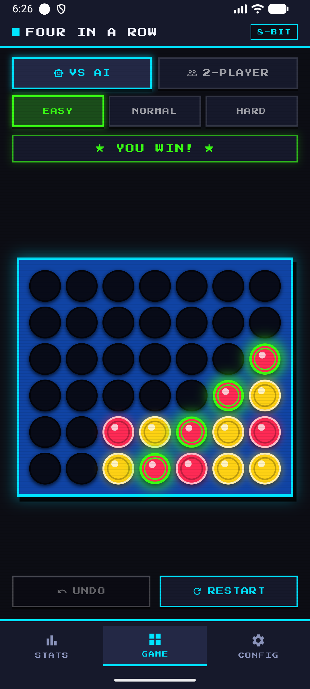
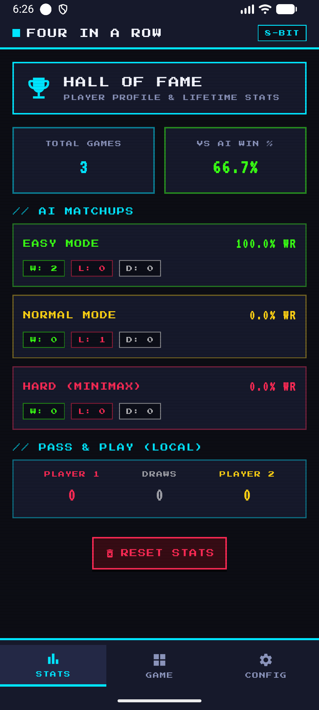
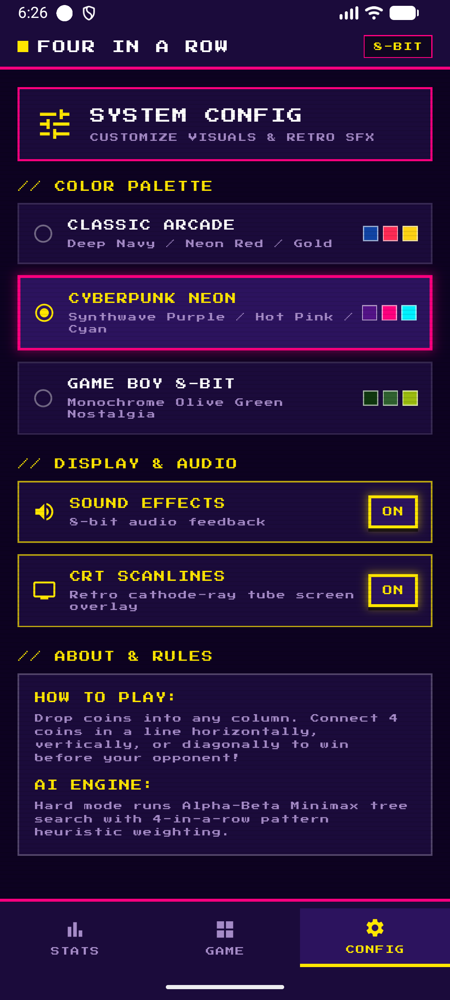

# 👾 FiarPixel (Retro Four in a Row)

<p align="center">
  
</p>

<p align="center">
  <strong>Un joc retro 8-bit / pixel-art Four-in-a-Row (Connect Four) construit în Flutter, cu moduri AI Minimax inteligente, mod 2-Player Pass & Play, efecte CRT scanlines și teme arcade neon.</strong>
</p>

<p align="center">
  
  
  
  
  
</p>

---

## 📸 Screenshots

| 🎮 Tabla de Joc (GAME) | 🏆 Sală de Trofee (STATS) | ⚙️ Setări & Teme (CONFIG) |
| :---: | :---: | :---: |
|  |  |  |
| *Tablă 6x7 cu neon glow, detectare victorie și efecte pixel-art* | *Statistici detaliate pe fiecare nivel AI și Pass & Play* | *Palete retro (Arcade, Cyberpunk, Game Boy) și efect CRT* |

---

## ✨ Funcționalități Principale

### 🕹️ Moduri de Joc
- **1 vs AI**:
  - 🟢 **Easy**: Mișcări pseudo-aleatorii cu verificare a victoriilor imediate.
  - 🟡 **Normal**: AI euristic ce blochează aliniamentele adversarului de 3 piese și ocupă strategic centrul tablei.
  - 🔴 **Hard (Minimax)**: Motor avansat Minimax cu tăiere **Alpha-Beta Pruning**, evaluare euristică pe ferestre de 4 poziții și ponderare pentru centrul tablei.
- **2-Player (Pass & Play)**:
  - Joc local în 2 pe același dispozitiv.
- **Funcții în partidă**: Undo (anulare mișcare) și Restart rapid.

### 🎨 Estetică Retro & Personalizare
- **3 Palete de Culori Retro**:
  - **Classic Arcade** (Deep Navy / Neon Red / Gold)
  - **Cyberpunk Neon** (Synthwave Purple / Hot Pink / Cyan)
  - **Game Boy 8-Bit** (Monocrom verde măslină nostalgic)
- **Filtru CRT Scanlines**: Efect autentic de tub catodic aplicat peste ecran (comutabil din setări).
- **Tipografie 8-bit**: Font retro `Press Start 2P` integrat prin Google Fonts.
- **Animații de cădere fluidă**: Piese pixel-art cu reflexii și evidențierea pieselor câștigătoare cu aură luminoasă.

### 📊 Statistici & Istoric (Hall of Fame)
- Număr total de partide jucate și rată globală de câștig împotriva AI.
- Evidență completă pe nivele de dificultate: Victorii, Înfrângeri, Remize și Win Rate procentual.
- Evidență dedicată meciurilor locale 1 vs 1.
- Salvare persistentă locală prin `shared_preferences`.

---

## 🏗️ Arhitectură & Structură de Fișiere

Proiectul respectă arhitectura curată Flutter bazată pe **Bloc/Cubit**, cu decuplare strictă între logica de calcul (AI & tablă) și interfața grafică:

```text
lib/
├── main.dart                      # Punct de intrare, configurare MultiBlocProvider & temă
├── game/
│   ├── ai/
│   │   ├── ai_easy.dart           # AI euristic simplu
│   │   ├── ai_normal.dart         # AI defensiv / control de centru
│   │   └── ai_minimax.dart        # Minimax cu Alpha-Beta Pruning (adâncime dinamică)
│   ├── board_logic.dart           # Logica matematică a grilei 6x7, gravitație & verificări 4-in-a-row
│   ├── game_controller.dart       # Cubit-ul principal de gestiune a stării meciului
│   ├── game_state.dart            # Starea imutabilă a jocului (jucător curent, status, câștigători)
│   ├── settings_cubit.dart        # Gestiunea temei, sunetelor și efectului CRT
│   └── stats_cubit.dart           # Gestiunea și persistarea statisticilor meciurilor
├── screens/
│   ├── home_screen.dart           # Scaffold cu BottomNavigationBar retro
│   └── tabs/
│       ├── game_tab.dart          # Ecranul jocului, selector mod & butoane acțiune
│       ├── stats_tab.dart         # Panoul Hall of Fame cu metrici de performanță
│       └── settings_tab.dart      # Selector palete culori, sunet & comutator CRT
├── theme/
│   └── retro_theme.dart           # Definițiile paletelor de culori retro și stiluri UI
└── widgets/
    ├── pixel_board.dart           # Grila vizuală interactivă cu efecte neon
    ├── pixel_coin.dart            # Piesa de joc stilizată pixel-art
    └── retro_button.dart          # Butoane tactile cu margini pixelate
```

---

## 🚀 Rulare și Instalare

### Cerințe preliminare
- [Flutter SDK](https://flutter.dev/docs/get-started/install) (versiune >= 3.13)
- [Dart SDK](https://dart.dev) (versiune >= 3.13)
- Dispozitiv Android / iOS sau emulator / browser Chrome (Web)

### Pași de instalare

1. **Clonează depozitul**:
   ```bash
   git clone https://github.com/int21hi/fiar_pixelify.git
   cd fiar_pixelify
   ```

2. **Instalează dependențele**:
   ```bash
   flutter pub get
   ```

3. **Rulează testele unitare**:
   ```bash
   flutter test
   ```

4. **Lansează aplicația**:
   ```bash
   # Pe dispozitiv conectat sau emulator
   flutter run

   # Sau pe Web
   flutter run -d chrome
   ```

---

## 🧪 Teste

Proiectul include teste automate pentru validarea logicii de joc:
- `test/board_logic_test.dart`: Testează gravitația, detectarea victoriilor (orizontal, vertical, diagonală pozitivă/negativă) și a remizelor.
- `test/game_controller_test.dart`: Testează tranzițiile de stare ale Cubit-ului, interacțiunea cu AI-ul și mecanismul de Undo.

Rulare teste:
```bash
flutter test
```

---

## 📄 Licență

Acest proiect este licențiat sub licența MIT.
